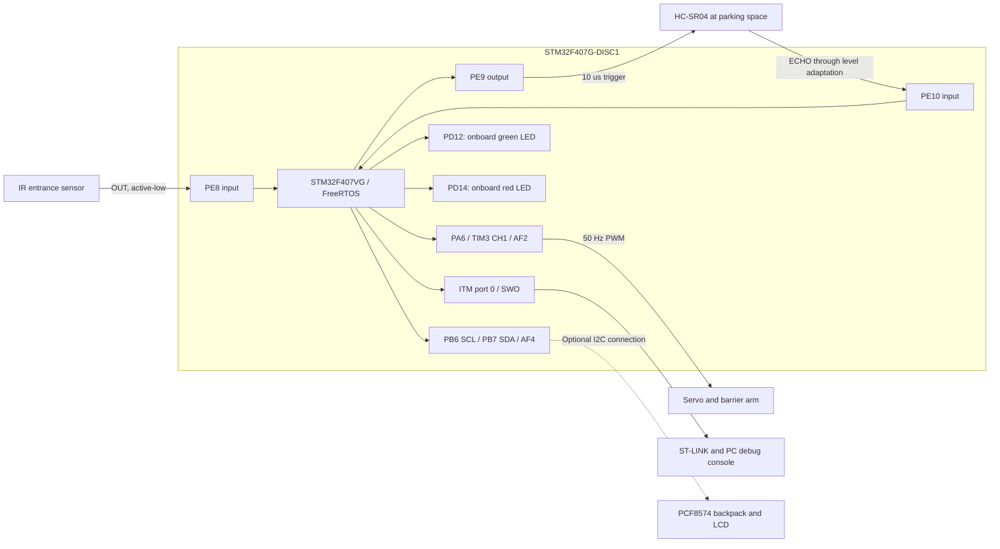
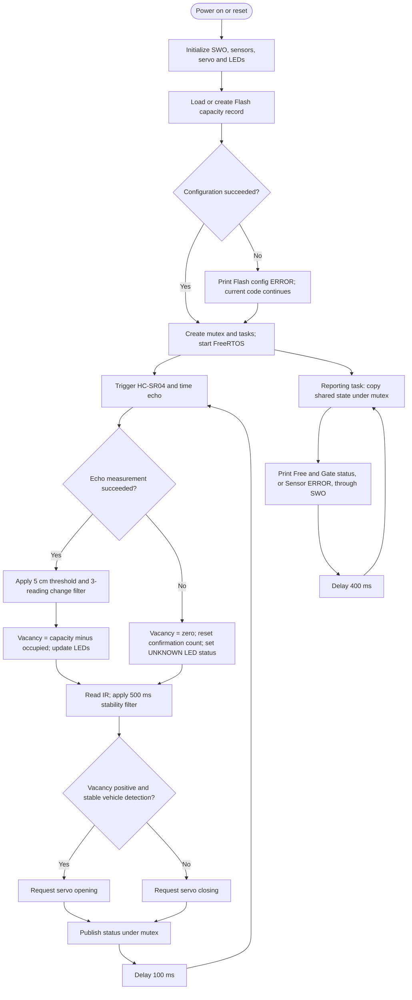

# Smart Parking System Using STM32F407 and FreeRTOS

An embedded parking prototype that monitors one parking space, detects a vehicle at the entrance, and operates a servo barrier when space is available. The firmware uses direct STM32 register access and FreeRTOS tasks for sensing, gate control, and status reporting.

> **Current implementation:** one monitored space, an HC-SR04 ultrasonic sensor, an active-low IR entrance sensor, a PWM servo, onboard status LEDs, and SWO debug output. An I2C LCD driver is included, but the running application does not initialize or update the LCD.

## Contents

- [Project Purpose](#project-purpose)
- [Objectives](#objectives)
- [Target Users](#target-users)
- [Components Used in This Device](#components-used-in-this-device)
- [Microcontroller Used](#microcontroller-used)
- [Hardware Schematic and Connections](#hardware-schematic-and-connections)
- [How the System Works](#how-the-system-works)
- [Technical Explanation](#technical-explanation)
- [Project Structure](#project-structure)
- [Build, Flash, and Run](#build-flash-and-run)
- [Configuration and Calibration](#configuration-and-calibration)
- [Expected Outcome](#expected-outcome)
- [Hardware Validation Checklist](#hardware-validation-checklist)
- [Known Limitations and Future Improvements](#known-limitations-and-future-improvements)
- [Troubleshooting](#troubleshooting)
- [References and Licensing](#references-and-licensing)

## Project Title

**Smart Parking System Using STM32F407 Microcontroller and FreeRTOS**

## Project Purpose

The project demonstrates how a microcontroller can automate parking-space monitoring and entrance control. A sensor observes the parking space, a second sensor detects an arriving vehicle, and the controller decides whether to open the barrier. LEDs and diagnostic messages communicate the current condition.
The hardware represents a **single-space parking model**; it does not count vehicles entering and leaving a larger car park.

## Objectives

1. Detect a vehicle at the entrance using an infrared obstacle sensor.
2. Determine whether the monitored space is occupied using ultrasonic distance measurements.
3. Request gate opening when the distance measurement succeeds, space is available, and a vehicle is detected at the entrance.
4. Reduce changes caused by noisy readings through consecutive-reading confirmation and time-based filtering.
5. Indicate status using LEDs and report diagnostics through SWO.
6. Retain the configured parking capacity in internal Flash across resets.
7. Separate control and reporting using FreeRTOS tasks and protect shared state with a mutex.
8. Provide a foundation for a local LCD interface and multiple independently monitored spaces.

## Target Users
- Parking operators evaluating a small demonstration before specifying a larger installation.

## Components Used in This Device

The project uses a **Tower Pro SG90 servo** and a **Sharp GP2Y0A21YK infrared sensor setup** for entrance detection.

| Category | Component | Quantity | Purpose / status |
| --- | --- | --- | --- |
| 1. Sensors | HC-SR04 ultrasonic distance sensor | 1 | Measures distance to an object in the parking space. |
| 1. Sensors | Sharp GP2Y0A21YK infrared sensor setup | 1 | Detects objects between **20 cm and 80 cm** at the entrance. |
| 2. Controller | STM32F407G-DISC1 development board | 1 | Hosts the STM32F407VG MCU and runs the firmware. |
| 3. Actuator | Tower Pro SG90 servo and barrier arm | 1 each | Moves the model barrier using PWM; endpoints require calibration. [SG90 datasheet](https://datasheet4u.com/datasheets/Tower-Pro/SG90/791970). |
| 4. Indicators | Onboard green LD4 and red LD5 LEDs | 1 each | Driven by PD12 and PD14; already fitted to the board. |
| 5. Display | HD44780-compatible character LCD with PCF8574 I2C backpack | 1, optional | Driver provided but not called by the application. A two-line module matches the driver. |
| 6. Power | Board USB supply and suitable regulated peripheral/servo supply | As needed | Powers the board, sensors, and motor according to their ratings. |
| 7. Interconnection | Jumper wires and breadboard or prototyping board | As needed | Connects the modules to the MCU. |
| 8. Signal conditioning | Voltage divider or appropriate level shifters | As needed | Adapts module signals to the MCU interface. |
| 9. Development | USB data cable and onboard ST-LINK debugger | 1 each | Programs the MCU and captures SWO diagnostics. |

The conventional HC-SR04 uses a 5 V supply and a trigger pulse of at least 10 microseconds. Its documented minimum measurement distance is 2 cm, so targets must be within its usable range. See the [HC-SR04 module datasheet](https://cdn.sparkfun.com/datasheets/Sensors/Proximity/HCSR04.pdf).

### IR detection range

In the implemented project setup, the **IR sensor detects objects between 20 cm and 80 cm**. It detects a vehicle at the entrance so the controller can evaluate whether to open the barrier. See the [Sharp GP2Y0A21YK datasheet](https://files.seeedstudio.com/wiki/Grove-80cm_Infrared_Proximity_Sensor/res/GP2Y0A21YK.pdf) for component specifications.

The firmware reads the entrance detection signal on **PE8** as an active-low input and applies a **500 ms stability filter**. The 20–80 cm range describes the implemented sensor setup; the firmware consumes a detection state rather than a numerical IR distance reading.

## Microcontroller Used

**STM32F407VGT6 on the STM32F407G-DISC1 board**, selected as `STM32F407VGTx` in the IDE project.

| Property | Project configuration |
| --- | --- |
| CPU | 32-bit Arm Cortex-M4 with floating-point support |
| Firmware clock assumption | 16 MHz internal HSI; the project does not configure a PLL |
| Flash layout | 896 KiB for the application; final 128 KiB reserved for configuration by the Flash linker script |
| RAM regions in linker script | 128 KiB normal SRAM and 64 KiB CCM RAM |
| Programming language | C, with assembly startup code |
| Peripheral programming | Direct memory-mapped register access; no ST HAL driver layer |
| RTOS | Bundled FreeRTOS reports `V11.1.0` in `FreeRTOS/include/task.h` |
| Toolchain configuration | STM32CubeIDE managed project, GNU Arm tools, Cortex-M4F hard-float ABI |

The MCU supports higher clock rates, but the timers, RTOS configuration, and SWO setup here assume **16 MHz**. Changing the clock requires updating all dependent timing settings.

## Hardware Schematic and Connections

### Functional wiring diagram

Solid arrows show the signal paths expected by the current firmware. The IR path represents the entrance sensor setup's active-low detection signal. The dashed LCD connection represents a supplied driver that the application does not use. Power and grounding are shown separately below. Mermaid diagrams render directly in GitHub's README view.



### Pin assignment

| Device / signal | MCU pin | Peripheral / mode | Meaning |
| --- | --- | --- | --- |
| IR digital output | `PE8` | GPIO input | LOW means vehicle detected; HIGH means no vehicle. |
| HC-SR04 TRIG | `PE9` | GPIO output | Starts a distance measurement. |
| HC-SR04 ECHO | `PE10` | GPIO input | Pulse width is timed using TIM2. |
| Servo signal | `PA6` | AF2, TIM3 channel 1 | PWM position command. |
| Green LED | `PD12` | Push-pull GPIO output | Vacant **or unknown** in the current driver. |
| Red LED | `PD14` | Push-pull GPIO output | Confirmed occupied state. |
| Optional LCD SCL | `PB6` | AF4, I2C1 clock | Configured only when the LCD driver is initialized. |
| Optional LCD SDA | `PB7` | AF4, I2C1 data | Configured only when the LCD driver is initialized. |
| Debug trace | `PB3` | SWO debug function | Carries trace to a compatible debugger. |

The onboard LED and debug pin assignments are documented in the [Discovery board user manual](https://www.st.com/resource/en/user_manual/dm00039084-discovery-kit-with-stm32f407vg-mcu-stmicroelectronics.pdf). The manual also identifies PA6 as shared with the onboard motion sensor and PB6/PB9 as the onboard audio I2C connection. Check the board revision and shared connections before attaching peripherals; ensure another device cannot drive the servo signal line.

### Power and assembly notes

- Power the servo from a supply rated for its operating and stall current. Do not power its motor from a GPIO or assume the board's logic supply can carry the load.
- Join grounds between the board and external supplies. Keep a separate servo supply's positive rail separate from USB/board power unless the documented board power arrangement allows their connection.
- Verify the IR output voltage and whether it is push-pull or open-collector. The driver does not configure an internal pull-up or pull-down, so the input needs a defined electrical level.
- Check the LCD backpack's supply and pull-ups. A 5 V backpack may pull SDA/SCL to that rail; use a compatible I2C interface.
- Mount the ultrasonic sensor facing the space and the IR sensor facing the entrance. Route servo current away from sensor wiring and provide appropriate supply decoupling.

## How the System Works

1. **Initialize hardware.** Startup enables floating-point access and sets the interrupt vector address. `main()` initializes SWO, IR input, ultrasonic timing, servo PWM, and LEDs.
2. **Load capacity.** Read the Flash configuration. If invalid, attempt to store the default capacity of one space.
3. **Start FreeRTOS.** Create a state mutex and two tasks, then start the scheduler.
4. **Measure the space.** Trigger the HC-SR04, time the echo, and convert the pulse width into centimeters.
5. **Confirm occupancy.** A distance of `5 cm` or less indicates occupied. Three consecutive readings supporting a change are required to change the stored occupancy state.
6. **Calculate vacancy.** After a successful measurement, `vacancy = capacity - occupied`, with occupied equal to zero or one. A failed measurement forces vacancy to zero for the gate decision.
7. **Filter entrance detection.** An observed IR change must remain the candidate state for at least 500 ms before it becomes the stable state.
8. **Command the barrier.** Request opening when vacancy is positive and stable IR detection reports a vehicle; otherwise request closing.
9. **Publish status.** Share a snapshot through the mutex. A lower-priority task prints availability and gate-command status, or a sensor error, through SWO.
10. **Repeat.** The control task delays 100 ms after its work; the reporting task delays 400 ms. These are delays, not guarantees of exact sampling periods.

### System flow diagram



### Steady-state behavior

This table assumes capacity initialization succeeded and filters have settled. Gate entries are **commands**, not measured physical positions.

| Ultrasonic measurement | Confirmed space state | Stable IR detection | Vacancy | Gate command | LED behavior |
| --- | --- | --- | --- | --- | --- |
| Successful | Vacant | No vehicle | `1/1` | Close | Green on |
| Successful | Vacant | Vehicle present | `1/1` | Open | Green on |
| Successful | Occupied | Either | `0/1` | Close | Red on |
| Failed / timed out | Previous state retained internally | Either | Forced to zero; report says `Sensor: ERROR` | Close | Green on: UNKNOWN maps to green |

**Startup detail:** occupancy starts as vacant. An initially occupied space needs three confirming measurements to change that state. After an ultrasonic failure, the previous occupancy state remains stored, but vacancy is forced to zero until a measurement succeeds again.

## Technical Explanation

### 1. Register-level control

[`Inc/my_stm32f4.h`](Inc/my_stm32f4.h) defines register structures and peripheral addresses. Drivers access registers such as `GPIOE->IDR`, `TIM3->CCR1`, and `RCC->AHB1ENR` directly.

Peripheral clocks are enabled before use. GPIO mode registers select input, output, or an alternate function. `BSRR` sets or clears output bits without reading and rewriting the output data register. This makes the relationship between firmware operations and hardware registers explicit.

### 2. Ultrasonic measurement

[`Src/hcsr04.c`](Src/hcsr04.c) configures TIM2 with a prescaler of `16 - 1`. With a 16 MHz timer input, each counter tick represents one microsecond.

```text
Timer frequency = 16,000,000 / (15 + 1) = 1,000,000 Hz
Distance in cm  = echo_duration_us × 0.0343 / 2
```

Division by two accounts for the sound's outward and return journey. An echo width of about 292 microseconds corresponds to 5 cm using the firmware conversion factor.

The driver sends a 10 microsecond trigger, polls for ECHO to rise, then polls for it to fall. Each wait has a separate 30,000 microsecond timeout, so a call can spend close to 60 ms waiting. A successful return means a pulse was captured within those limits; the driver does not perform additional minimum/maximum distance validation.

### 3. Sensor filtering

[`Src/tasks.c`](Src/tasks.c) contains two filters:

- **Ultrasonic:** a change from vacant to occupied, or occupied to vacant, needs three consecutive supporting measurements. A failed measurement resets the confirmation count. This is a consecutive-reading filter, not an average or a pair of hysteresis thresholds.
- **IR:** a candidate transition is accepted after at least 500 ms based on the RTOS tick. Both detection and release use this delay.

IR pulses between task samples may be missed. Sensor processing also pauses while the same task performs the opening ramp described below.

### 4. Servo PWM and motion

[`Src/servo.c`](Src/servo.c) uses TIM3 channel 1 on PA6 with a 1 MHz counter and a 20,000-count period:

```text
PWM frequency = 16,000,000 / ((15 + 1) × (19,999 + 1)) = 50 Hz
Closed target = 1,450 us high pulse
Open target   = 2,400 us high pulse
Step size     = 10 us
```

`Servo_SetAngle()` takes a Boolean open/close request, despite its name; it does not accept degrees.

Movement is currently asymmetric. Opening performs all 95 steps inside the function with a 20 ms RTOS delay between steps, taking about 1.9 seconds plus scheduling overhead. Other tasks can run during those delays, but the sensor/gate task cannot recheck sensors until the opening call returns. Closing performs only one 10 microsecond step per control-loop call, so a complete close takes approximately 9.5 seconds or longer.

Calibrate pulse widths for the actual servo and barrier geometry. There is no position feedback, so printed gate status indicates the requested target rather than confirmation that the barrier reached it.

### 5. FreeRTOS architecture

| Task | Priority | Allocated stack | Work | Delay after work |
| --- | --- | --- | --- | --- |
| `SensorGateTask` | Idle + 2 | 256 words / 1,024 bytes | Measurements, filters, LEDs, IR, servo, and state publication | 100 ms |
| `DisplayTask` | Idle + 1 | 512 words / 2,048 bytes | Copies shared state and prints to SWO; no LCD writes | 400 ms |

The selected Cortex-M4F port uses 32-bit stack words. [`Inc/FreeRTOSConfig.h`](Inc/FreeRTOSConfig.h) enables preemption, a 1,000 Hz tick, mutexes, and dynamic allocation. `heap_4.c` provides the configured 15,360-byte FreeRTOS heap.

The mutex protects vacancy, sensor-success status, and the gate-command flag. The control task waits up to 50 ms to publish; the reporting task waits up to 100 ms to copy. A failed acquisition skips that update, retaining the previous snapshot. The mutex does not serialize the tasks' `printf()` calls.

### 6. Flash configuration

[`Src/parking_config.c`](Src/parking_config.c) stores three words at `0x080E0000`, in Flash sector 11:

| Field | Value / purpose |
| --- | --- |
| `magic` | `0x5041524B`, identifying a parking record |
| `capacity` | Must equal `PARKING_DEFAULT_CAPACITY`, currently `1` |
| `check` | `magic XOR capacity XOR 0xA57C39E1` |

A valid record is reused. A missing or invalid record causes the sector to be erased and a new record to be programmed and verified. The Flash linker script limits the application to 896 KiB, leaving the last 128 KiB outside its placement range.

Only capacity is retained. Occupancy and vacancy are remeasured after reset, avoiding Flash writes on every parking event. The XOR field is a simple integrity check, not a cryptographic checksum. A full-chip erase removes the record.

**Failure handling needs improvement:** when configuration initialization fails, `main()` prints an error and still starts the tasks. Capacity may remain zero; subtracting an occupied value of one from an unsigned zero can wrap to a large positive vacancy. A configuration failure therefore does not currently guarantee a closed-gate decision.

### 7. SWO output and optional LCD

[`Src/retarget.c`](Src/retarget.c) redirects `printf()` to ITM stimulus port 0, configured for 2 MHz SWO with a 16 MHz CPU clock. This is debugger trace output, not a UART serial terminal.

Illustrative messages from the code are:

```text
Loading config
PE8=0 | IR raw=1 | IR stable=1 | ultrasonic OK=1 | vacancy=1
Free: 1/1 | Gate: OPEN
Free: 0/1 | Gate: CLOSED
Sensor: ERROR
```

[`Src/lcd_i2c.c`](Src/lcd_i2c.c) provides I2C1 at 100 kHz and a four-bit HD44780 interface through a PCF8574 backpack. `LCD_ADDR` is `0x4E`, the write-address byte for seven-bit address `0x27`. The assumed backpack mapping is RS on bit 0, enable on bit 2, backlight on bit 3, and data on bits 4–7.

Activating the LCD requires an initialization call and display updates in the reporting task. The driver's I2C polling loops also need timeout/error handling to handle a disconnected or incorrectly addressed LCD reliably.

## Project Structure

```text
Smart-Parking-system/
|-- Inc/                         Headers, register definitions, RTOS settings
|-- Src/
|   |-- main.c                   Hardware initialization and application entry
|   |-- system_stm32f4.c         FPU access and interrupt vector initialization
|   |-- freertos.c              Task creation entry and scheduler startup
|   |-- tasks.c                 Sensors, gate logic, filters, and reporting
|   |-- hcsr04.c                Ultrasonic trigger and echo timing
|   |-- ir_sensor.c             Active-low entrance sensor input
|   |-- servo.c                 TIM3 PWM and barrier movement
|   |-- led.c                   Onboard status LEDs
|   |-- parking_config.c        Flash configuration record
|   |-- lcd_i2c.c               Optional LCD driver
|   |-- retarget.c              printf output through SWO
|   |-- syscalls.c              C library system-call stubs
|   `-- sysmem.c                C library heap support
|-- FreeRTOS/                    Kernel, Cortex-M4F port, and heap_4
|-- Startup/                     Startup assembly and interrupt vector table
|-- STM32F407VGTX_FLASH.ld        Flash layout with reserved configuration area
|-- STM32F407VGTX_RAM.ld          Alternative RAM execution linker script
|-- .project / .cproject         IDE project and build configuration
|-- Smart Parking System Debug.launch
`-- README.md
```

`Debug/` and `Release/` are ignored build-output directories. The normal IDE configurations select the Flash linker script.

## Build, Flash, and Run

### Requirements

- STM32CubeIDE with its GNU Arm toolchain and ST-LINK support.
- STM32F407G-DISC1 board and USB data cable.
- Hardware and wiring described above.
- Debugger configuration capable of SWO capture for the current logging implementation.

### Procedure

1. Obtain the repository and open an STM32CubeIDE workspace.
2. Import this directory as an existing Eclipse/STM32CubeIDE project using `.project` and `.cproject`. Its project name is **Smart Parking System**.
3. Select **Debug**. Confirm target `STM32F407VGTx` and linker script `STM32F407VGTX_FLASH.ld`.
4. Verify the include paths contain `Inc`, `FreeRTOS/include`, and `FreeRTOS/portable/GCC/ARM_CM4F`; these are present in the project settings.
5. Build the project. The debug launch configuration expects `Debug/Smart Parking System.elf`.
6. Connect the board through its ST-LINK USB connection. Check power and wiring, and keep the barrier clear during the first motion test.
7. Launch **Smart Parking System Debug**, or create an equivalent ST-LINK/SWD configuration.
8. Configure SWV for a **16 MHz core clock**, capture **ITM stimulus port 0**, and match the firmware's **2 MHz SWO** rate. Start trace capture before resuming execution.
9. Resume and inspect initialization, sensor messages, LED states, and gate motion.

The supplied launch configuration enables SWV and sets a 16 MHz trace core clock. Exact menu labels depend on the installed IDE version. The SWO writer waits for the ITM port without a timeout; absent or stalled trace support can interfere with progress, so standalone operation needs separate validation.

## Configuration and Calibration

| Setting | Current value | Location | Considerations |
| --- | --- | --- | --- |
| Capacity | `1` | `Inc/parking_config.h` | Additional spaces need additional sensing and occupancy logic. |
| Occupied distance | `5.0f` cm | `Src/tasks.c` | Match the model geometry and mounting. |
| Occupancy confirmation | `3` readings | `Src/tasks.c` | More readings increase stability and response delay. |
| IR confirmation | `500` ms | `Src/tasks.c` | Applies to arrival and departure. |
| IR object-detection range | `20–80` cm | Implemented entrance sensor setup | Firmware reads the active-low detection state on PE8. |
| Echo timeout | `30000` us per wait | `Src/hcsr04.c` | Echo rise and fall have separate timeouts. |
| Closed/open PWM | `1450` / `2400` us | `Src/servo.c` | Calibrate without forcing mechanical stops. |
| Servo step | `10` us | `Src/servo.c` | Opening and closing use different pacing. |
| Control/report delay | `100` / `400` ms | `Src/tasks.c` | Actual intervals include work and scheduling time. |
| LCD write-address byte | `0x4E` | `Inc/lcd_i2c.h` | Match the backpack's address and bit mapping. |
| RTOS CPU clock / tick | `16000000` / `1000` Hz | `Inc/FreeRTOSConfig.h` | Keep consistent with the clock tree. |

Start with an unloaded servo, verify endpoints, then attach the barrier. Test the ultrasonic threshold with the space empty and occupied. An empty space should still produce a valid reflection beyond the threshold; an out-of-range target may cause a timeout, which the application treats as unavailable.

## Expected Outcome

The expected result is a single-space demonstration that detects occupancy, accepts an entrance request when space is available, moves the barrier, and reports status.

**Checked items indicate functionality present in the source code, not a claim that physical hardware tests have passed.**

- [x] Read an active-low entrance IR sensor.
- [x] Measure ultrasonic echo duration and convert it to distance.
- [x] Apply a distance threshold and three-reading occupancy-change filter.
- [x] Apply 500 ms confirmation to entrance-sensor transitions.
- [x] Calculate vacancy for the configured single space.
- [x] Generate opening and closing PWM commands for the servo.
- [x] Drive onboard green and red LEDs.
- [x] Force vacancy to zero when an ultrasonic measurement fails.
- [x] Report parking and gate-command status through SWO.
- [x] Store and validate capacity in internal Flash.
- [x] Run control and reporting as FreeRTOS tasks with a shared-state mutex.
- [ ] Display live parking status on the I2C LCD.
- [ ] Complete and record hardware acceptance testing.
- [ ] Ensure startup, Flash errors, and sensor faults produce an unambiguous unavailable state.
- [ ] Support multiple independently monitored spaces.

## Hardware Validation Checklist

The items below are marked complete in the project checklist. This README includes no test captures or measurements, and formal hardware acceptance remains open.

- [x] Confirm the firmware builds and both FreeRTOS tasks run on the target.
- [x] Confirm valid empty-space readings produce `Free: 1/1` after filters settle.
- [x] Place an object within the occupied threshold; confirm three readings cause red LED indication and `Free: 0/1`.
- [x] Remove the object; confirm three vacant readings restore availability.
- [x] With space available, hold a vehicle at the IR sensor through the 500 ms filter and observe opening.
- [x] Remove the vehicle and observe release filtering and the full closing movement.
- [x] With the space occupied, verify an entrance request does not command opening.
- [x] Simulate an echo timeout; verify `Sensor: ERROR` and a closing request, and record the green-on UNKNOWN indication.
- [x] Reset with the space empty and occupied; record startup confirmation behavior.
- [x] Verify a valid capacity record survives reset and vacancy is remeasured.
- [x] Check motion range, supply stability under load, and response to sensor changes during opening.


## Known Limitations and Future Improvements

| Current limitation | Consequence / proposed improvement |
| --- | --- |
| One ultrasonic channel | Add sensing and occupancy state per space, then sum vacancies. Changing capacity alone is insufficient. |
| LCD driver not called | Integrate initialization and reporting with I2C timeouts. |
| UNKNOWN status turns green on | Make sensor failure distinct from confirmed vacancy. |
| Occupancy starts vacant | Require a confirmed initial state before allowing entrance. |
| Flash failure does not stop task startup | Disable admission on invalid configuration and prevent unsigned vacancy underflow. |
| Opening occupies the sensor/gate task for about 1.9 seconds | Use a nonblocking motion state machine or separate actuator task. |
| Closing advances once per control loop | Make motion timing independent of sensing and logging work. |
| No passage, obstruction, or position feedback | Add sensors and gate states before use beyond a model demonstration. |
| Ultrasonic GPIO polling | Consider timer input capture for timing accuracy and lower CPU use. |
| SWO can wait indefinitely; both tasks print | Add bounded/nonblocking logging and message serialization. |
| Task creation return values unchecked | Handle allocation failures and add stack/heap diagnostics. |
| No network, booking, payment, or exit-counting functions | These require separate feature design and potentially more hardware. |

Low-power Stop mode and external-interrupt wake-up are also future work. The current application continuously runs scheduled tasks.

## Troubleshooting

| Symptom | Checks |
| --- | --- |
| No SWO messages | Check ST-LINK, SWV enablement, 16 MHz core clock, 2 MHz SWO rate, ITM port 0, and trace capture. |
| `Sensor: ERROR` | Check sensor power, ground, TRIG/ECHO, signal levels, target range, and alignment. |
| Green LED during sensor error | This matches `LED_STATUS_UNKNOWN` handling in `Src/led.c`; use diagnostics to distinguish it from vacancy. |
| Gate does not open | Confirm valid vacancy, PE8 LOW on detection, 500 ms stable detection, servo power, and PA6 PWM. |
| Gate closes slowly | The current driver changes pulse width once per control loop; a full close takes about 9.5 seconds or more. |
| No LCD status | The application does not call the LCD driver. Integrate it before checking address, contrast, and wiring for live output. |
| Reset during servo motion | Check motor supply capacity, ground, decoupling, wiring resistance, and mechanical load. |
| `Flash config ERROR` | Inspect sector 11 programming/erase status and protection; gate behavior is not reliable on this error path. |
| Application stops at a print call | Inspect the SWO/ITM wait loop and trace configuration. |

## References and Licensing

Implementation details are based on the source files linked above. Component documentation:

- [ST Discovery board user manual](https://www.st.com/resource/en/user_manual/dm00039084-discovery-kit-with-stm32f407vg-mcu-stmicroelectronics.pdf): board connections and shared peripherals.
- [HC-SR04 module datasheet](https://cdn.sparkfun.com/datasheets/Sensors/Proximity/HCSR04.pdf): ultrasonic measurement and timing.
- [Tower Pro SG90 servo datasheet](https://datasheet4u.com/datasheets/Tower-Pro/SG90/791970): servo reference supplied for this project.
- [Sharp GP2Y0A21YK IR sensor datasheet](https://files.seeedstudio.com/wiki/Grove-80cm_Infrared_Proximity_Sensor/res/GP2Y0A21YK.pdf): component characteristics and output curves. The implemented project's object-detection range is **20–80 cm**.

Check the exact component variants and LCD backpack fitted to the build when verifying ratings and connections.

The bundled FreeRTOS kernel has its own [license](FreeRTOS/LICENSE.md). ST-generated files contain their own notices. No separate project-wide license file is present; component notices should not be interpreted as a license grant for every project file.
